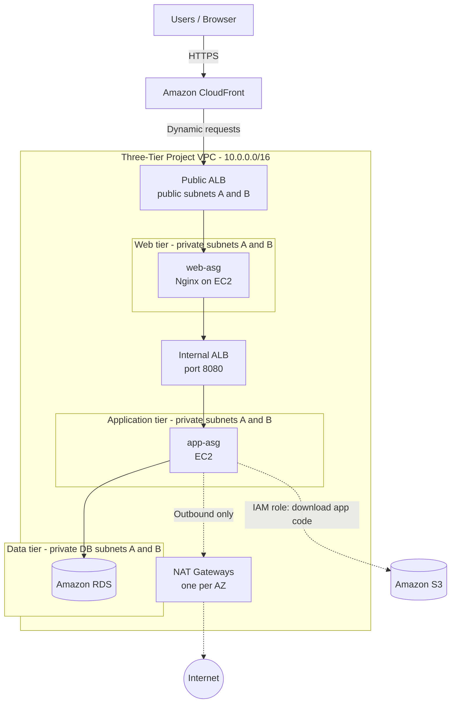

# AWS-Three-Tier-Web-Application-Architecture

A hands-on AWS project that deploys a scalable, highly available, and secure three-tier web application across two Availability Zones using **CloudFront, Application Load Balancers, EC2 Auto Scaling Groups, Amazon RDS, S3, IAM, and a custom VPC**.

**Region:** Asia Pacific (Sydney) — `ap-southeast-2`

---

## Table of Contents

1. [Overview](#overview)
2. [Architecture](#architecture)
3. [AWS Services Used](#aws-services-used)
4. [Network Design](#network-design)
5. [Security Design](#security-design)
6. [Auto Scaling Configuration](#auto-scaling-configuration)
7. [S3 Access with IAM Role](#s3-access-with-iam-role)
8. [Request Flow](#request-flow)
9. [Deployment Steps](#deployment-steps)
10. [Validation](#validation)
11. [Troubleshooting Log](#troubleshooting-log)
12. [Future Improvements](#future-improvements)
13. [Cost and Cleanup](#cost-and-cleanup)
14. [Skills Demonstrated](#skills-demonstrated)
15. [Author](#author)

---

## Overview

The application is split into three isolated tiers so each layer can be secured, scaled and maintained independently:

| Tier | Components | Subnets |
|---|---|---|
| **Presentation (Web)** | Public ALB, Nginx on EC2 (`web-asg`) | Public (ALB, NAT) and private web subnets |
| **Application** | Internal ALB, EC2 (`app-asg`) | Private application subnets |
| **Data** | Amazon RDS | Private database subnets (no internet route) |

Amazon CloudFront is the public entry point. Only the load balancers and NAT Gateways sit in public subnets; every EC2 instance and the database run in private subnets.

## Architecture


Simplified logical view:



## AWS Services Used

| Service | Purpose |
|---|---|
| Amazon VPC | Isolated network (`10.0.0.0/16`) with public and private subnets |
| Internet Gateway | Internet access for the public subnets |
| NAT Gateways (one per AZ) | Outbound-only internet access for private instances |
| Amazon CloudFront | CDN and public entry point; caches content and forwards dynamic requests |
| Application Load Balancers (2) | Public ALB for the web tier, internal ALB for the application tier |
| EC2 Auto Scaling Groups (2) | Maintain and scale web and application instances |
| Launch Templates | Define instance configuration for each tier |
| Amazon EC2 (`t3.micro`) | Nginx web servers and application servers |
| Amazon RDS | Managed relational database in private subnets |
| Amazon S3 | Stores application code (`application-code/` prefix) |
| AWS IAM | Instance role for least-privilege S3 access |
| Security Groups | Layered, source-referenced access control between tiers |

## Network Design

**VPC CIDR:** `10.0.0.0/16` across two Availability Zones.

| Subnet | AZ | CIDR | Route table | Default route |
|---|---|---|---|---|
| Public A | A | `10.0.1.0/24` | Public RT | `0.0.0.0/0` → Internet Gateway |
| Public B | B | `10.0.2.0/24` | Public RT | `0.0.0.0/0` → Internet Gateway |
| Private Web A | A | `10.0.11.0/24` | Private RT A | `0.0.0.0/0` → NAT Gateway A |
| Private Web B | B | `10.0.12.0/24` | Private RT B | `0.0.0.0/0` → NAT Gateway B |
| Private App A | A | `10.0.21.0/24` | Private RT A | `0.0.0.0/0` → NAT Gateway A |
| Private App B | B | `10.0.22.0/24` | Private RT B | `0.0.0.0/0` → NAT Gateway B |
| Private DB A | A | `10.0.31.0/24` | DB RT | Local only (no internet route) |
| Private DB B | B | `10.0.32.0/24` | DB RT | Local only (no internet route) |

Design notes:

- One NAT Gateway per AZ keeps outbound access working if a single AZ fails.
- NAT Gateways only allow outbound connections initiated from inside the VPC; they do not replace the Internet Gateway or the load balancers.
- The database subnets have no route to the internet in either direction.

## Security Design

Security groups reference each other as sources instead of using IP ranges, so each tier only accepts traffic from the tier directly above it.

| Security group | Inbound | Source |
|---|---|---|
| Public ALB SG | TCP 80 / 443 | CloudFront |
| Web SG | TCP 80 | Public ALB SG |
| Internal ALB SG | TCP 8080 | Web SG |
| App SG | TCP 8080 | Internal ALB SG |
| DB SG | Database port | App SG |

Additional controls:

- No EC2 instance has a public IP address; all instances are in private subnets.
- The S3 bucket is private and accessed only through the EC2 instance role.
- No long-lived access keys are stored on instances; the role provides temporary credentials.

## Auto Scaling Configuration

Each tier has one Auto Scaling Group that spans both Availability Zones, so with a desired capacity of 2 the group runs one instance per AZ.

| Setting | Web tier — `web-asg` | Application tier — `app-asg` |
|---|---|---|
| Launch template | `web-temp` | `app-tp` |
| Min / Desired / Max | 2 / 2 / 4 | 2 / 2 / 4 |
| Instance type | `t3.micro` | `t3.micro` |
| Availability Zones | 2 | 2 |
| Load balancer | Public ALB | Internal ALB |
| Observed health | 2/2 healthy | 2/2 healthy |

Both groups are attached to their ALB target groups, so unhealthy instances are removed from rotation and can be replaced automatically.

## S3 Access with IAM Role

Application code is stored in a private S3 bucket and downloaded by EC2 instances at launch using the instance role `ThreeTier-Project-Role`.

- **Bucket:** `threetier-project-bucket03`
- **Prefix:** `application-code/`

Least-privilege policy attached to the role:

```json
{
  "Version": "2012-10-17",
  "Statement": [
    {
      "Sid": "ListApplicationPrefix",
      "Effect": "Allow",
      "Action": "s3:ListBucket",
      "Resource": "arn:aws:s3:::threetier-project-bucket03",
      "Condition": {
        "StringLike": { "s3:prefix": ["application-code/*"] }
      }
    },
    {
      "Sid": "ReadApplicationObjects",
      "Effect": "Allow",
      "Action": "s3:GetObject",
      "Resource": "arn:aws:s3:::threetier-project-bucket03/application-code/*"
    }
  ]
}
```

## Request Flow

1. A user opens the application through the CloudFront distribution URL.
2. CloudFront serves cached content or forwards dynamic requests to the public ALB.
3. The public ALB distributes traffic to healthy Nginx instances in the web tier.
4. Nginx forwards application requests to the internal ALB on port 8080.
5. The internal ALB distributes requests across healthy application instances.
6. The application tier reads from and writes to Amazon RDS.
7. Application instances use their IAM role to download code from S3.
8. Private instances use the NAT Gateways for outbound-only internet access (updates, external APIs).
9. The response returns along the same path to the user.

## Deployment Steps

1. **Network:** create the VPC, eight subnets across two AZs, Internet Gateway and route tables.
2. **NAT:** create one NAT Gateway (with Elastic IP) per AZ and point each private route table to its local NAT Gateway.
3. **Security groups:** create the five security groups with source-referenced rules.
4. **Storage and IAM:** create the S3 bucket, upload code under `application-code/`, create `ThreeTier-Project-Role`.
5. **Database:** create a DB subnet group from the two private DB subnets and launch Amazon RDS.
6. **Application tier:** create the `app-tp` launch template, internal ALB, target group and `app-asg`.
7. **Web tier:** create the `web-temp` launch template (Nginx), public ALB, target group and `web-asg`.
8. **CloudFront:** create a distribution with the public ALB as the origin.
9. **Validate:** confirm healthy targets and test through the CloudFront URL.

## Validation

On a web instance:

```bash
sudo systemctl status nginx --no-pager
sudo ss -lntp | grep ':80'
curl -I http://localhost/
```

Expected: Nginx active, listening on port 80, and `HTTP/1.1 200 OK`.

On an application instance:

```bash
aws s3 ls s3://threetier-project-bucket03/application-code/
```

From the AWS CLI:

```bash
aws elbv2 describe-target-health --target-group-arn <target-group-arn>
```

Expected: all targets report `healthy`. A passing `curl localhost` does not prove the ALB can reach the instance, so always check target health as well.

## Troubleshooting Log

| Issue | Cause | Resolution |
|---|---|---|
| Web targets unhealthy | Apache (`httpd`) and Nginx both tried to bind port 80 | Removed Apache so Nginx could own port 80; verified with `ss -lntp` and `curl` |
| S3 `AccessDenied` on code download | IAM role had `s3:GetObject` but lacked `s3:ListBucket` | Added `s3:ListBucket` on the bucket, scoped to the `application-code/` prefix |
| Target health checks failing | Mismatch risk between health-check port/path and the service | Checked target group health-check settings, security group rules between ALB and targets, and service status |

## Future Improvements

- Enforce end-to-end HTTPS with an ACM certificate on the ALB and an HTTPS origin policy in CloudFront.
- Add AWS WAF on the CloudFront distribution.
- Add target-tracking scaling policies (for example, average CPU at 50%) to both Auto Scaling Groups and load test them.
- Add an S3 Gateway VPC Endpoint so S3 traffic stays off the NAT Gateways and lowers data processing cost.
- Use AWS Systems Manager Session Manager for administration instead of SSH.
- Add CloudWatch dashboards and alarms for ALB 5xx errors, unhealthy hosts and RDS metrics.
- Review RDS Multi-AZ, automated backups and recovery settings.
- Provision the whole stack with Terraform or AWS CloudFormation.

## Cost and Cleanup

NAT Gateways, load balancers, EC2, RDS and CloudFront incur charges while provisioned. To tear the project down, delete in this order:

1. CloudFront distribution (disable first, then delete)
2. Auto Scaling Groups, then launch templates
3. Public and internal ALBs and target groups
4. RDS instance and DB subnet group
5. NAT Gateways, then release the Elastic IPs
6. S3 bucket contents and bucket, IAM role and policy
7. Security groups, route tables, subnets, Internet Gateway and VPC

## Skills Demonstrated

- Designing a multi-AZ, multi-tier VPC with public and private subnets and route tables
- Layered security with source-referenced security groups and IAM instance roles
- Load balancing with public and internal ALBs and target group health checks
- EC2 Auto Scaling with launch templates
- Linux service troubleshooting (port conflicts, service verification)
- Diagnosing IAM permission errors (S3 `AccessDenied`)
- Cost awareness and resource cleanup

## Author

**Abutalha Parkote**
AWS | Cloud Engineering | DevOps | Infrastructure and Networking

[LinkedIn](https://www.linkedin.com/in/parkote-abutalha) ·
